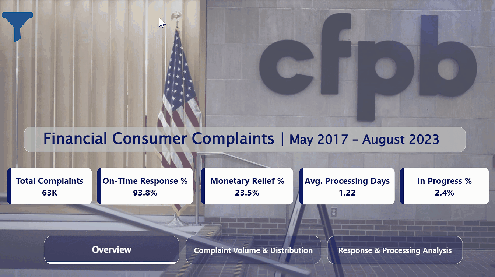

# 📊 Financial Consumer Complaints Dashboard

An interactive **Power BI dashboard** designed to analyze consumer complaints and provide insights into complaint volume, company responses, processing performance, products, submission channels, and geographic distribution.

> **Data Period:** May 2017 – August 2023

---

## 🖼️ Dashboard Preview

  

---

## 📌 Project Overview

This project analyzes consumer complaint data from the **Consumer Financial Protection Bureau (CFPB)** and transforms raw complaint data into an interactive and visually focused Power BI dashboard.

The dashboard is designed to help users understand:

- How many complaints were submitted?
- Which financial products received the most complaints?
- How quickly were complaints processed?
- How often did companies respond on time?
- What types of responses were provided?
- Which submission channels were most commonly used?
- How did complaint volumes change over time?
- How were complaints distributed across states?

---

## 🎯 Project Objectives

The main objectives of this project are to:

- Analyze overall consumer complaint volume.
- Identify the products generating the highest number of complaints.
- Evaluate company response performance.
- Analyze average complaint processing time.
- Compare complaint submission channels.
- Identify trends in complaints over time.
- Explore geographic complaint distribution.
- Provide an interactive dashboard for data exploration and filtering.

---

## 🛠️ Tools & Technologies

- **Microsoft Power BI**
- **Power Query** – Data cleaning and transformation
- **DAX** – Measures and KPI calculations
- **Data Visualization** – Interactive charts, cards, tables, and maps

---

## 📊 Key Performance Indicators

| KPI | Value |
|---|---:|
| Total Complaints | 62,516 |
| On-Time Response | 93.8% |
| Monetary Relief | 23.5% |
| Average Processing Time | 1.22 days |
| In Progress | 2.4% |

---

## 📑 Dashboard Pages

### 1. Overview

The Overview page provides a high-level summary of the dataset through key performance indicators.

It allows users to quickly understand the overall complaint volume and response performance before exploring the detailed analysis.

The page also supports interactive filtering to analyze KPIs based on selected dimensions.

### 2. Response & Processing Analysis

This page focuses on how companies responded to consumer complaints and how efficiently complaints were processed.

**Visualizations include:**

- Consumer Response Breakdown
- Company Response by Product
- On-Time Response Rate Over Time
- On-Time Response Rate by Product
- Average Processing Time by Submission Channel

### 3. Complaint Volume & Distribution

This page focuses on where complaints came from and how complaint volume changed over time.

**Visualizations include:**

- Complaints by Product
- Complaints by Submission Channel
- Complaints by State
- Complaint Trend Over Time
- Product Complaints Over the Years

---

## 🔎 Data Preparation

The dataset was cleaned and transformed before visualization.

One of the transformations was combining:

**Web + Web Referral → Web**

Both categories were treated as one web-based submission channel for the analysis.

After combining these categories, the total Web submissions were:

**45,513 complaints**

---

## 📈 Key Findings

- **Checking/Savings** accounts generated the highest number of complaints.
- **Web** was the most frequently used complaint submission channel.
- Complaint volume reached its highest level in **2022**.
- The overall **on-time response rate was 93.8%**.
- The average complaint processing time was approximately **1.22 days**.
- Complaint volumes and response patterns varied across financial products and states.

---

## 🎨 Dashboard Design

The dashboard uses a consistent visual theme with:

- Dark navy blue as the primary color
- Light neutral backgrounds
- KPI cards for quick performance monitoring
- Horizontal bar charts for product comparisons
- Line and area charts for time-based trends
- Geographic mapping for state-level analysis
- Interactive navigation between dashboard pages
- Interactive filters for deeper exploration

The design focuses on keeping the dashboard clean, readable, and easy to navigate while maintaining a professional financial-data aesthetic.

---

## 💡 Business Questions Answered

1. What is the total number of consumer complaints?
2. Which products receive the most complaints?
3. How has complaint volume changed over time?
4. How quickly are complaints processed?
5. How often do companies respond on time?
6. Which products have different response patterns?
7. Which submission channels are most commonly used?
8. Which states have higher complaint volumes?
9. How do complaint patterns differ across years and products?

---

## 🚀 Conclusion

This project demonstrates how raw consumer complaint data can be transformed into an interactive business intelligence solution using **Power BI**.

The dashboard combines data cleaning, transformation, DAX calculations, KPI development, visualization, and interactive filtering to provide a clear overview of consumer complaint patterns and company response performance.

---

## 👩‍💻 Author

**Maysa El-Dramally**

[LinkedIn](https://www.linkedin.com/in/maysa-el-dramally-5b6951426/)
